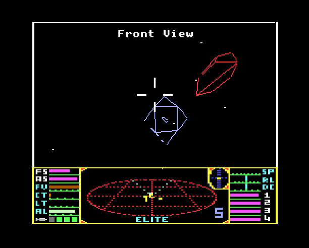

# This is a fork markmoxon/elite-source-code-commodore-64 with VIC-II Kawari Optimizations

This working tree now builds a PAL-only VIC-II Kawari port. See
[KAWARI.md](KAWARI.md) for the build/run instructions, VRAM renderer design,
tests and current limitations. The historical documentation describing
the upstream game can be found from the original repository.

Same C64 Experience but with Flicker Free 25 FPS and some added color.

A prebuilt 5-compiled-game-disks/elite-kawari-pal.d64 is available.

Only a PAL port is available.  NTSC has not been tested.

See KAWARI.md for custom build instructions.

NOTE: Kawari firmware 1.20 or higher is required to run this.

YouTube: https://www.youtube.com/watch?v=y2TPc_Ik8oc
